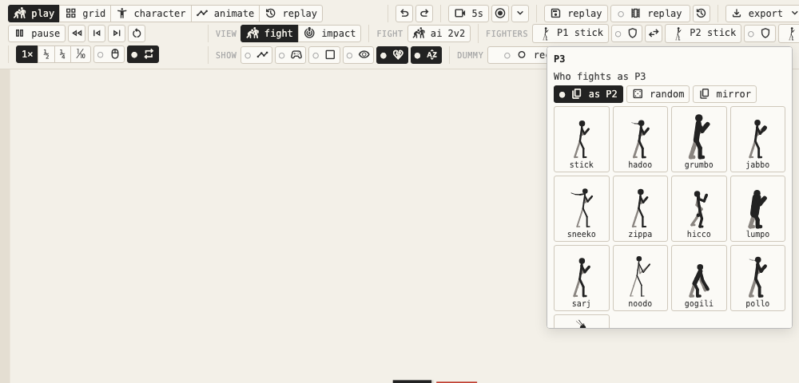
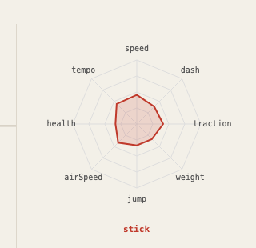
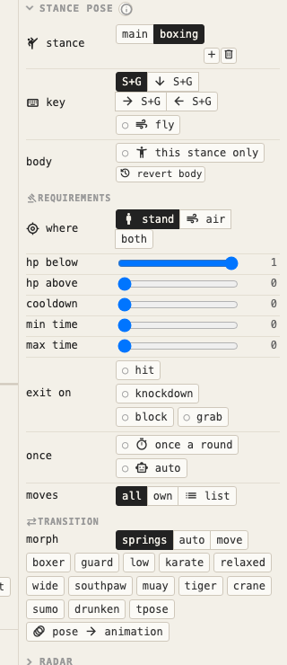
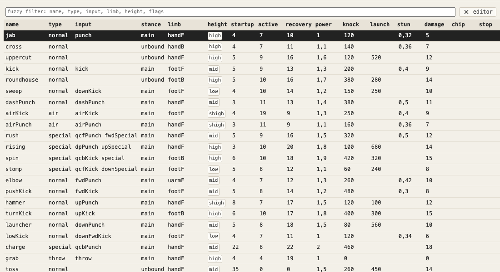
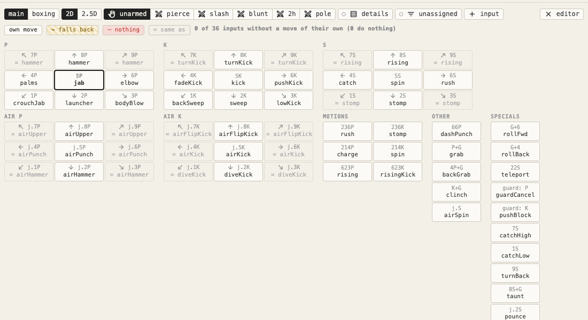
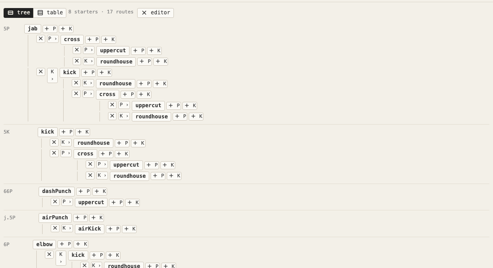

# Editing characters and moves

[← docs index](README.md)

Building fighters and their movesets. The editors themselves (dragging joints, the timeline) are on the [Modes](modes.md#character) page; this page is about what you build with them.

| Section | Where it is |
|---|---|
| [Characters](#characters) | side panel in character and animate |
| [Bone shapes](#bone-shapes) | bone panel → shape, cap, shade…; reparenting in the tree and canvas |
| [Moves and inputs](#moves-and-inputs) | the move table over the stage |
| [Movement layers](#movement-layers) | animate → move group → + → layer |
| [Input table](#input-table) | the **moves** group → inputs |
| [Combos](#combos) | the **moves** group → combos |

## Characters

The character panel shows a grid of drawings, all at one scale.

| Every character, drawn at one scale |
| --- |
|  |

### The roster

**stick** is the plain base. The rest are stereotypes, each with signature moves bound to every input, motions, a second stance, stats and a gait:

| Character | Type | Signature moves |
|---|---|---|
| hadoo | the shoto | ki blast on S, rising uppercut, whirlwind kick on the floor and in the air |
| grumbo | the grappler | huge and slow: a spinning piledriver on a half circle, bear hug, spinning lariat |
| jabbo | the boxer | punches on K too, dash straight and upper, rush flurry, a bounce |
| sneeko | the ninja | double jump, shuriken on the floor and in the air, slide, vanishing kick, a scarf |
| zippa | the kicker | lightning legs, bird kick, head stomp, crane kick |
| hicco | the drunken master | sways and slides, a tipsy roll, a sway that catches a blow and strikes back |
| lumpo | the sumo | hundred slap, flying torpedo, belt throw, sumo splash |
| sarj | the soldier | sonic boom, flash kick, spinning knuckle, knee bazooka |
| noodo | the yogi | long limbs, yoga fire, drill kick, a warp, floaty |
| gogili | the beast | long arms, hunched, rolling ball, electricity, a bite |
| honky | the luchador | giant swing, german suplex, dropkick, plancha, high jumps |
| gloomo | the boss demon | horns, wings, tail, four arms, dark orb, psycho dash, warp claw, skull dive |
| centaur | the trampling horse | a horizontal horse body: tramples forward, a donkey kick, rears up to headbutt, or to box with its forelegs |
| houndo | the hound | fights posed on all fours: a tackle, a low claw rake, rears up to bite, a hind-leg kick, a howl |
| otkopod | the tentacled pod-creature | eight tentacles, always: a sequential four-tentacle flurry, all eight slamming down at once, an ink burst and a coiling wrap throw |
| clampo | the wrestler | huge and slow: a bear hug into a slam (a combo throw), a leg-lock ankle twist, a running tackle, a diving splash |

### Your own

- **random** generates one: proportions, thickness, extra limbs, stance, stats. The sliders button tunes the generator; a grid of nine random characters lets you pick one to keep.
- **copy** to make your own; **rename**, **revert**, **export / import** as JSON. A built-in can't be deleted or renamed in place (revert needs it to stay around to undo your edits against) — renaming one makes an edited copy under the new name, and **delete** on one disables it instead: hidden from pickers and random picks until **enable** or **revert** brings it back.
- Edits are saved in the browser automatically. Only changed built-ins are stored, so a stored copy of an old built-in needs **revert** to get the new version.
- Any move can be bound to an input (J, K with any direction, running, air, motions), so copied moves are playable.

### Preview

The bar under the live preview picks what it plays: **showcase** (a scripted demo: punches, a kick, a sweep, a jump kick, a dash into a grab and throw, a special, then backs off), **walk** (forward and back, to check the walk cycle), **ai vs ai** (two copies fight with the engine AI), or **solo** (just the one character, no opponent, on your keyboard: it stands still until you press keys). A scenario button next to them opens every other scenario, built-in or your own, fuzzy-searchable.

Outside solo, a fuzzy-searchable character picker next to it sets the opponent — **self** (a copy of the one you're editing, the default) or any character in the roster — so you can see how your edits read against a specific foe instead of only against a copy of yourself. The controller icon next to it hands your keyboard to the opponent instead of its script/AI — handy for holding it still, guarding, or moving it into a weapon or throw's reach.

A **send to play** button on the right jumps to Play with the same scenario and opponent, so you can keep going with Play's full toolset (recording, replays, the scenario builder) instead of just watching.

### Colour

By default a fighter is coloured by which player it is (P1 black, P2 red, P3 blue…), the same for every character. The **colour** row gives a character its own colour instead — a preset swatch or any colour from the picker — used everywhere it's drawn, in a fight too, overriding the player slot. **auto** goes back to the player-slot colour.

### Stats

Stats scale the fight settings for that character. Three groups, with group buttons and the body experiment:

| Group | Stats |
|---|---|
| ground | walk speed, dash speed, traction, turnaround, weight |
| air | jump height (whatever its gravity), max jumps (-1 = infinite air jumps), gravity, air speed, air acceleration, fall speed, air dodge, air dash |
| fight | health, toughness, tempo, springs, grab range, chip taken, block pushback taken, combo damage taken, knockback taken, its own just guard's push on the attacker, its own push block's force |

The character tab keeps all of this in one **Stats** section with a sub-tab each: ground, air, fight, walk (walk & idle) and shadow. The last tab picked is remembered, and the palette opens one directly (`stats: air`).

The **radar** lives in the bones panel under the character view (its tree / table / radar switch, or `stats radar` in the palette). It draws the chosen stats: each axis runs from the stat's minimum to its maximum, the dashed ring is 1. Other characters can be overlaid to compare.

| The stats radar |
| --- |
|  |

### Shadow

The **shadow** section (the shadow tab of the character's Stats section) sets the shadow drawn under the character in a fight. Drawing only: the fight plays out the same.

- **shape:** ellipse (the default oval), circle (a round blob, w is its radius), body (the figure itself squashed and sheared onto the floor) or **off**. The oval and circle sit centred under the whole body and widen to its length (a centaur's horse body is covered too).
- **w, h:** the oval's half-width and half-height. For body, w / 22 and h / 22 scale the figure's width and height on the floor.
- **alpha** (darkness) and **colour** (black or an effect colour: a purple glow under a ghost).
- **dx, dy:** moves it from the feet. **lift:** how fast it shrinks as the fighter rises (0 = never). **skew** (body only): how far it leans.
- Only what differs from the default is saved (`shadow` in the character JSON), with group buttons to randomize or reset.

### Stance bodies

A stance can have its own body. Pick the stance under the stance pose and switch on **this stance only**:

- Bone edits (length, thickness, shape, effects, the other properties), new limbs and bones, stats, walk & idle and combo links then change that stance only. Off, they change the character in every stance.
- **Del** hides a bone in the stance (with everything below it): it isn't drawn, has no hurtbox and doesn't walk. The bone panel's **alpha** slider shows it again (drag it up from 0) — alpha also works outside stance editing, and between 0 and 1 the bone draws translucent but stays solid.
- **size** scales the whole body in the stance: every length, thickness and hurtbox.
- Health stays the character's. **revert body** throws the stance's body away.
- The editor and the preview show the stance picked. In a fight the switch keeps the running move; new bones grow in.
- In the character JSON: `stances[i].body = { bones: { id: { len, … , alpha } }, add: [bones], scale, stats, gait, chains: { move: next }, shadow, col }`. Only what differs is stored. `shadow` merges field by field (change just its alpha, say); `col` replaces outright, including back to auto.
- **Main** (stance 0) can have a body of its own too, the same way: it becomes the character's actual body, and every other stance still varies from it as usual. In the JSON: `main.body`.

### Stance requirements



Under a stance's body row, **requirements** set when it can be taken and what ends it (unset: as before, on the ground, any time):

- **where:** on the ground (the default), in the air, or both. A press in the air waits for the ground as before.
- **hp below / hp above:** only with at most / at least this share of health left (a desperation stance at 0.3).
- **cooldown:** seconds after leaving it before it can be taken again. **min time:** seconds before it can be left. **max time:** seconds, then back to main on its own.
- **exit on:** hit, knocked down, blocking, grabbed: back to main.
- **once a round.**
- **auto:** no key needed — it is taken the moment the requirements above hold, and left the moment they stop holding (min time still applies).
- **moves:** all (its binds over main's), own (only its own binds), or a list of the moves it allows.
- A stance key whose stances are all blocked does nothing. In the JSON: `stances[i].req`, only what differs.

**Main** gets requirements too, picked the same way: where, hp, cooldown, min time, once a round and moves all gate a switch *back* into main. Max time, exit on and auto are left out — they send a stance back to main on their own, and main has nowhere else to go. In the JSON: `main.req`.

Next to the stance's key, **fly** makes it hover instead of fall: gravity and the ground are suspended while in it, and ↑ / ↓ fly up / down instead of jumping. Leaving the stance (a key, `exitOn`, `maxT`, or a hit) hands it back to normal gravity wherever it is. In the JSON: `stances[i].fly`; main can fly too, in `main.fly`.

### Stance transitions

**transition** (under the requirements) sets how the body changes switching to the stance, and back to main from it:

- **springs** (the default): the springs chase the new pose.
- **auto:** the stance pose and the bone lengths blend over **frames** (60 a second) with the **ease**. New bones grow from nothing, hidden ones shrink away.
  - **ease** **bezier** draws a curve graph under the switch, the same as a key's [bezier easing](modes.md#bezier-easing): drag its two handles (above the box overshoots, below it anticipates), double-click to reset. Saved as `morph.bz`. `stance blend: bezier` in the palette switches the selected stance to it.
  - **Per-bone timing:** a bone's **morphDelay** (bone properties, 0 … 0.9) is the share of the blend it waits before it moves. Every bone still lands by the end of the blend, so a delayed bone moves later and faster.
  - **Example:** a 20-frame blend with `morphDelay` 0.5 on the hair and 0.3 on the tail. The body turns over all 20 frames, the tail starts at frame 6, and the hair at frame 10, so they settle last, like follow-through.
  - **Grow limbs** (auto only): limbs the stance adds grow out of their parent joint one bone after the next, root first, and their thickness (a circle's size too) swells with their length. Limbs it hides pull back in from the tip. Each bone's delay comes from its depth in the limb, up to 0.75 of the blend; a bone's own `morphDelay` still wins.
  - **Example:** a demon stance that adds a two-bone horn with an orb at the end, 40 frames, grow on. The horn's root starts at once, the tip at about frame 13 and the orb at frame 20, so the horn extrudes from the head. Back to main, a lost arm folds into the shoulder hand first.
- **move:** a keyframed transition move plays: `mainToCrane` switching into a stance named crane (or the move picked), `craneToMain` back to main. **new transition move** and **back** make them (half way between the two poses, then into the stance) and open them in animate. The move eases from wherever the body is, like any move; a switch forced by the stance's limits (max time, exit on) skips it.
- In the JSON: `stances[i].morph = { mode, T, ease, bz, move, grow }`, only what differs; `morphDelay` is on each bone.

### In the air

- Every fighter gets air drift, a top fall speed with ↓ fast fall, an **air dodge** (G in the air: intangible; with a direction, a burst) and an **air dash** (double tap in the air), once per jump.
- **Super jump:** ↓ then jump. superJump × the launch speed, within superJumpWindow, from a longer squat.
- **Triangle jump:** a jump in the air next to a wall springs off it, up and away (wallJump, wallJumpPush, wallJumpReach). It gives back the air dodge and dash.

### Turning

- A fighter can't start a move until it has turned halfway (**turnSpeed**).
- While turning, the body is never thinner than **turnWidth** (0 = the old paper-thin flip through a profile, 1 = mirrored at once).
- **turnTuck:** the body gathers in as it turns: knees bend, arms pull in, the back hunches.

### Bodies

- A four-legged character kicks with its forelegs (knees forward); its hind legs bend like hocks.
- Fighters collide by their bodies' extent (torso and legs in the stance, behind and in front). Two four-legged characters keep their horse bodies apart, and the AI measures range from the body's front.

## Bone shapes

A bone's **shape** (bone panel, bone table, or the palette's `bone shape:` entries) sets how it is drawn:

- **line:** a stroke from the parent joint (the default).
- **circle:** a disc on the joint, radius = length (heads, fists).
- **spline:** one smooth curve through this bone and the single chain of line bones below it, tapering to the last one's thickness (tails, tentacles). Drawing only; every bone keeps its own hurtbox.
- **chain:** a rope. The bone splits into **segs** segments (2-16, default 6), each looser and more dangling than the last, drawn as one spline (whips, scarves, hair). It swings on the same springs as dangle and whip, so fights stay deterministic. Poses and moves still name the bone itself; its children hang from the rope's end.
- **fill:** a filled shape through the parent joint, the bone's end and the single bone chain below it, closed back on itself, or through **fill to**'s joint (a cape from the neck to a hand). It fills a lighter grey of the ink unless the bone has a shade; its own line is the edge.
- **socket:** an invisible attach point: not drawn, never hit, in no limb chain. A held weapon goes on the first socket (front side first) instead of the front hand.

Line bones also have:

- **cap:** how the ends are drawn: round (default), square (pushed out by half the width), flat (cut at the joints) or point (narrows to a tip). Square and flat make boxes and pills.
- **taper:** how much thinner the line ends than it starts (0 even, 1 a point).
- **shade:** a grey level, from the figure's own ink (0) toward paper white. Grey only, so characters stay monochrome.
- **z:** a draw-order layer. Lower layers draw under higher ones whatever their side; side (back, centre, front) orders bones inside a layer.
- **morphDelay:** in an auto stance blend, the share of the blend (0 … 0.9) the bone waits before it moves, so it lands after the rest. See [Stance transitions](#stance-transitions).
- **aim:** in a fight, how far the bone turns toward the nearest foe's upper body (1 = straight at it): heads that watch, an arm that tracks.

### Reorganizing bones

- **Rig tools:** see [Rig tools](#rig-tools) below. In **setup** mode, Alt+drag on the canvas reparents.
- **Bone tree** (the bones panel under the character view: drag its top edge to resize it, double-click it for the default size; its **tree / table** switch flips it to the bone table): drag a bone onto another to hang it, and everything below it, from that bone. Hold Alt as you drop to move it before that bone in the draw order instead. Drop it on the **hang from the hip** row to make it a root.
- **Canvas:** Alt+drag a joint onto another joint (or the hip square) to reparent it. A dashed line shows where it goes.
- **Bone table:** click a bone's parent cell to pick a new parent; drag an id onto another row to reorder.
- **copy** (bones panel head) copies the selected bone and its subtree to the other side. **parts** beside it opens the [appendages library](#parts-appendages-library).

A bone can never hang from its own subtree.

## Rig tools

A column docked at the right edge of the character view, for posing and rigging. Show or hide it with the toolbar's **rig** button, or with `rig tools` in the palette (⌘K). On screens narrower than 700 px it becomes a sheet at the bottom of the stage. It is hidden while the experiment grid is open.

Every tool is also in the palette as `rig: …`, and every change is undoable (⌘Z).

### Mode: setup and animate

| Mode | Dragging a joint | Alt+drag a joint | Use it for |
|------|------------------|------------------|------------|
| **setup** (default) | sets the bone's stance angle **and length** | drops the bone onto another joint to reparent it | building or reshaping the rig |
| **animate** | only turns the bone; lengths and parents stay put | same as a plain drag | posing a stance without changing the rig by accident |

**Example:** you've finished building a tail and want to tune the stance without stretching it. Switch to **animate**, drag the tail joints, and the lengths stay as built.

### Pose

The pose clipboard holds the stance pose: every bone's angle, by bone name. It is kept in your browser, so it survives a reload and switching characters.

| Button | What it does |
|--------|--------------|
| **copy** | Copies the current stance's pose. |
| **paste** | Pastes onto every bone the clip and this character share. Bones the clip doesn't have are left alone. |
| **selected** | Pastes onto the selected bones only. |
| **reset** | Puts the selected bones back to the bind pose: the built-in character's stance, or for your own character, the pose it had when you opened it. |

**Examples:**
- *Copy a guard from another character:* open `boxer`, **copy**, open your character, **paste**. Arms and legs named the same (`uarmF`, `farmF`, `thighF`…) take the pose.
- *Fix just the arms:* select `uarmF`, `farmF`, `handF` (⌘/Ctrl+click), then **selected**.
- *Undo an experiment on the legs:* select the leg bones and press **reset**.

### Selection

The line under **Selection** names the selected bone (or how many are selected) and shows *pose copied* when the clipboard is full.

- **isolate** fades every unselected bone to 20% in the character view, so you can see a single limb on a crowded rig (a centaur, a winged character).
- **ghost tip** draws a fading red trail of the selected bone's tip in the preview fight (about 1.5 s long). Use it to judge a strike's arc: a jab should trace a straight line, a hook a wide curve, a kick a clean sweep.

**Example:** select `handF`, turn on **ghost tip**, and watch the preview fight. If the jab's trail curves up at the end, lower the arm in the strike key.

### Constraints

Constraints make one bone react to another automatically, in every fight and in the preview fight. They act on the pose the springs chase, so springs, lag and follow-through still apply on top. They are deterministic, so replays and online play stay in sync. Characters without constraints play exactly as before.

They are set on the **selected** bones (several at once works). Pick **—** to remove one, or run `rig: clear constraints` from the palette to remove both. The static character view shows the stance as authored, so watch the preview fight to see a constraint at work.

#### follow

The bone copies how far another bone has turned **away from the stance**, multiplied by **follow mix**.

| follow mix | Effect |
|------------|--------|
| `1` | turns exactly as much as the followed bone |
| `0.5` | half as much: a softer echo |
| `0` | no effect (same as off) |
| `-1` | the same amount the other way: a counter-swing |

The followed bone's turn is measured from its stance angle, so in the stance the follower sits where you posed it.

**Examples:**
- *Hair that follows the head:* select the hair bone, **follow** `head`, mix `0.6`. When the head snaps back from a hit, the hair turns 60% as far, and its own springs and `dangle` add the swing.
- *A cape that follows the torso:* select the cape's first bone, **follow** `chest`, mix `0.5`.
- *Tail counterbalance:* select the tail root, **follow** `chest`, mix `-0.4`. Leaning forward swings the tail back.

#### reach (IK)

The bone and its **parent** bend so the bone's end touches the end of the **reached** bone (two-bone IK). The elbow or knee stays on the side it already bends to. **reach mix** blends between the animated pose (`0`) and full contact (`1`).

- The bone needs a parent: the two bones it bends are the bone and its parent (forearm and upper arm, shin and thigh).
- If the target is out of reach, the limb stretches straight toward it as far as it can.
- A bone can't reach itself, and it shouldn't reach a bone inside its own limb.

**Examples:**
- *Two-handed staff:* select `handB`, **reach** the staff's tip bone (or `handF` for a grip on the same spot), mix `1`. However the front arm swings, the back hand stays on the staff.
- *Hand on a hip prop:* add a `socket` on the hip, select `handB`, **reach** the socket, mix `0.7`. The hand rests near it but still moves a little with the animation.
- *Feet on a ledge:* select `footF`, **reach** a socket bone on a prop, mix `1`.

#### In the JSON

Constraints are saved on the bone, and only values that differ from the default are written:

```json
{ "id": "hair", "parent": "head", "len": 18, "follow": "head", "followMix": 0.6 }
{ "id": "handB", "parent": "farmB", "len": 6, "reach": "staffTip", "reachMix": 1 }
```

| Field | Default | Range | Meaning |
|-------|---------|-------|---------|
| `follow` | none | a bone id | the bone whose turn this one copies |
| `followMix` | `1` | `-1` … `1` | how much of that turn |
| `reach` | none | a bone id | the bone whose end this one's end goes to |
| `reachMix` | `1` | `0` … `1` | how far toward it |

Follow constraints are applied before reach ones, and each pass goes parents first. A reach can therefore land on a bone that is itself following another.

### Bone groups

The **Groups** section of the rig tools picks a set of bones in one click, handy on big rigs like the centaur.

- **Role groups** come from the rig: **arms**, **legs**, **tails**, **heads** and so on, every visible bone with that role.
- **Your groups:** select bones (⌘/Ctrl+click in the character view, Shift+click in the tree), then **save group** and name it. It is saved with the character (`groups` in the JSON) and listed under the role groups; × deletes it (undoable, the bones stay).
- **Click** a group to select its bones; **Shift+click** adds them to the current selection. Every selected bone takes the next property change, isolate ghosts the rest, and the dopesheet's **selected** filter lists just them.
- The palette has **group: save** and **group: \<name>** for each group.

Example: on a centaur, save `horse` (the four horse legs and the barrel) and `rider` (the torso and arms). Pick `horse`, turn on isolate, and tune the gait without the rider in the way; Shift+click `tails` to add the tail.

### Parts (appendages library)

**parts** in the bones panel head adds a ready-made part: **arm**, **leg**, **head**, **tail**, **tentacle**, **wing**, **horn** or **socket** (an invisible attach point: a held weapon goes on the first socket instead of the front hand), or one of your own saved parts. A part becomes plain bones, so you can edit, recolour, constrain, skin and group it like any other bone afterwards.

| Option | What it does |
|---|---|
| **size** | S, M or L: ×0.7, ×1 or ×1.4 on lengths (thickness grows more slowly). |
| **joints** | For tails, tentacles, wings and horns: how many bones in the chain. **auto** uses the part's own count (tentacle 6, tail and wing 3, horn 2). |
| **mirror** | **pair** adds a front and a back copy, like arms. **single** adds one. **auto** follows the part (arms, legs, wings and horns come in pairs). |
| **hit** | **cosmetic** parts are never hit (no hurtbox). **hittable** ones get a hurtbox about their thickness. **auto** keeps the part's own. |

- A part goes on the **selected bone**, any bone, a socket too. A pair on a sided bone puts its back copy on the partner bone, so wings on `uarmF` land on `uarmF` and `uarmB`.
- Wings and horns curl back, and tentacles and tails taper toward the tip. Each bone down a chain lags a little more, so a part sways and follows through on its own (tail role: no walk cycle, just follow-through and wander).
- Extra pairs number themselves (`uarm2F`, `wing2F`), so a part never overwrites a bone.
- **Your parts:** select the first bone of a part (say `uarmF` or a tail root), then **save part** in the picker's **mine** row and name it. It and every bone below it are saved in this browser and listed under **mine**, ready to add to any character with the same options. × deletes one. Side letters are dropped (`uarmF` saves as `uarm`), so mirror can make a pair of it.
- The palette has **part: \<name>** for each part, using the picker's current options, and **part: save**.

Example: select `chest`, pick **L** and **pair**, then **wing**. Select `head` and add **horn**. Add a **tentacle** with **joints 8** at the hips for a long, floppy tail.

### Skins

A skin is a named look for one character, made only of bone **drawing** settings: `thick`, `cap`, `taper`, `shade`, `curve` and `z` (draw layer). A skin never touches lengths, hurtboxes or motion, so it can't change a fight, and replays stay valid. Skins are procedural, with no images, and they keep the character monochrome because `shade` is grey only.

| Control | What it does |
|---------|--------------|
| **save skin** | Asks for a name and saves every bone's current drawing settings as a new skin, which becomes the applied one. |
| a skin's button | Applies it: each bone the skin names takes its saved values, and fields the skin doesn't set go back to their defaults. Bones the skin doesn't name keep their look. Undoable. The applied skin shows a ✓. |
| Alt+click a skin | Updates that skin from the bones as they are now. |
| **delete** | Deletes the applied skin. The bones keep their current look. |

The palette has `skin: save` and `skin: <name>` for each of the open character's skins.

**Examples:**
- *Heavy:* select every limb, set **thick** 9 and **cap** square, then **save skin** as `heavy`.
- *Sketch:* set **thick** 2, **taper** 0.6 and **curve** 0.1 on the limbs, then save it as `sketch`.
- *Ghost:* set **shade** 0.6 on every bone and save it as `ghost`. Click **heavy**, **sketch** or **ghost** to switch between them.

In the JSON: `skins: { "heavy": { "uarmF": { "thick": 9, "cap": "square" }, … } }` and `skin: "heavy"` for the one applied last.

### Reparenting

There are three ways to hang a bone (and everything below it) from another bone:

- **Bone tree** (under the character view): drag a bone onto another. Hold Alt as you drop to reorder it in the draw order instead. Drop it on **hang from the hip** to make it a root.
- **Canvas** (setup mode): Alt+drag a joint onto another joint, or onto the hip square. A dashed line shows where it will go.
- **Bone table:** click the parent cell and pick a new parent.

## Moves and inputs



Every direction × P / K can be a different move, Virtua Fighter style. The stick's set:

| Input | Move | Input | Move |
|---|---|---|---|
| 6P | elbow | 6K | push kick |
| 8P | hammer overhead | 8K | turn kick |
| 2P | launcher | 2K | sweep |
| 1P | crouch jab | 1K | back sweep |
| 3P | body blow | 3K | low kick |
| | | 4K | fade kick (steps back as it kicks) |
| 7P | backfist (2.5D) | 7K | crescent, an overhead (2.5D) |
| | | 9K | flying knee (2.5D) |

- **In the air**, ↑ and ↓ have their own moves: j.8P upper and j.8K flip kick launch, j.2P hammer spikes into a bounce, j.2K dives forward.
- **623K** is an invincible rising kick; **S in the air** a spinning kick.
- **↓↙← J** is charge: an unblockable palm strike with a long wind-up.
- Every input of the stick has a move. A diagonal without a move falls back to its vertical, then to neutral.
- The ninja adds 3K slide and 9K axe kick.
- The AI uses all of these, and mixes overheads and lows against a guard.

### Move properties

- **armor** (per key): the hit does damage but the move goes on.
- **counter hit:** a hit during the opponent's startup or active frames (counterHit: more damage and stun).
- **crumple** the victim, **wall** splat it, or **bounce** it off the floor.

### The move table

The **panels** group → **table** puts every move in a table over the stage: type, input, stance, limb, height, startup / active / recovery, power, knock, launch, stun, damage, chip, flags.

- Click a header to sort. The fuzzy filter matches any text column.
- Edit values in place. Editing frames retimes that phase's keys.
- Click a row to open the move in the keyframe editor; hover it to play the move next to the cursor.

## Sounds and effects

A key's **events** row (in its fold, under the key editor) picks what plays as that key is reached, drawing/sound only — the fight plays out the same with or without them: **spark** (a hit flash: hit, heavy, slash, blunt or none), **sound** (whoosh, hit, thud, block, none, or any custom sound), and **after** (after-images, for fast dashes and teleports). **key fx** below it stacks up to 4 looks (fire, aura, sparks…) on the move's striking limbs, the whole body, or a bone group, each with its own colour, size and speed; a move's own **fx** sets the default a key can inherit, override, or clear.

Neither sounds nor looks are picked from a closed list — both can be designed from scratch.

### Sounds

The sounds view (a view of the [Fx](modes.md#fx) tab). Every sound is synthesized live (WebAudio, no files): a noise layer (a filtered sweep, with a resonance) and/or a tone layer (an oscillator sweep, with a detune), each with its own gain, over an attack and a decay. A waveform preview above the sliders renders the actual sound (silently, offline) so you can see the shape you're tuning. Every one is tunable, the built-ins included — whoosh, hit, thud and block for the fight, kick, snare, hihat, openhat, clap, tom, click and bell for the tracker — a slider per parameter, a **test** button; **revert** puts a built-in back to its shipped values (it keeps its name, since other moves already pick it by name). **new sound** (or **duplicate**) makes a wholly new one instead, free to rename or delete. A sound appears anywhere a sound is picked, including the key events row above and the [grid](modes.md#grid) tab, which also shows its waveform and can play it on hover.

### Effects (looks)

Looks (fire, aura, lightning…) are designed in their own tab, not a panel over the stage — see [Fx](modes.md#fx): a gallery of every one, built-in and custom, each tunable with a live preview (on a character or a plain segment), randomize and a two-variable experiment grid. A custom look appears anywhere a look is picked, including a move or key's fx (above) or a bone's.

### Tracker

The tracker view (a view of the [Fx](modes.md#fx) tab). Your tracks are listed in a table (tempo, steps, row count, play / duplicate / delete); pick one to edit it. A simple step sequencer built from your own sounds: a track has a tempo and a number of steps (8, 16 or 32), and any number of rows, each picking a sound and a grid of beats it plays on, also a table, numbered every step. **play** loops it, highlighting the step currently sounding.

A step is off, or on at a pitch: click toggles it, scroll over it shifts the pitch ±12 semitones (shown on the step once it's off zero), shifting both the sound's noise and tone layers together. Each row also has **turn all on / off**, **invert** and **randomize**, besides remove; **new track** (or **+ row**) starts one, **duplicate** copies a whole track, rename it freely.

## Movement layers

**animate → move group → + → layer.** Every movement state can get a keyframed layer on top of its procedural / IK motion.

**States:** crouch, rise, fall, fly, flip, run, dash, backDash, backWalk, airDash, guard, hurt, tumble, lying, dizzy, turn.

- The layer is a move named after the state: **crouchLayer** (or **craneCrouchLayer** in a stance named crane).
- Its keys start at the state's procedural pose (its ref).
- In a fight, its keys play (looping) from the moment the state begins, and their offsets from the ref are added to the procedural pose.
- **mix** sets how much: 0 = off, 1 = as keyed. Back walk and turn fade in by speed, or by how far through the turn.
- Layers group as **layer** in the move picker. Delete one to go back.
- **fly** only applies in a stance with **fly** on (see [Stance bodies](#stance-bodies)); it's the only state that overrides rise/fall instead of adding to them.
- The stick ships with **dashLayer**, **backDashLayer** and **airDashLayer**: a single committed lunge on a dash (forward, backward, in the air) instead of a sped-up walk cycle. It also ships **wallJumpLayer**: a push off the wall, kicking away from it (see [Jumping](fighting.md#jumping)); and **runLayer**: a steep forward lean with both arms swept back, held for as long as the run lasts (a ninja run). Every built-in fighter inherits them; override or delete one on a character to replace it with its own.

## Input table



The **panels** group → **inputs**, or the controller button by a move's inputs.

A direction pad per button (P, K, S, air P, air K; numpad layout, 6 = toward the opponent), plus the motions and the other inputs. Above it, pick the moveset: the plane (2D / 2.5D), the stance, and the hand (unarmed or a weapon class).

| Pad looks | Meaning |
|---|---|
| plain | a move of its own |
| amber, ↪ | falls back to another move (shown) |
| red | does nothing |
| dotted, = | no slot of its own: plays another input |
| outlined | the move being edited |

- Click a pad or row to give it a move: the open one, the default, none, or any move. ⌘Z undoes.
- **details** opens a table of every input beside the pads, a split rather than a scroll down (the unassigned ones on request).
- **details:** the move an input plays has its startup, height, damage, power and stun edited in place. The move itself changes, so every input playing it changes too.
- **+ input** adds an input of your own: a motion in numpad notation plus P or K, e.g. `41236` = ←↙↓↘→ (↑ directions count too). It's kept with the character (motions) and tried before the built-in motions, longest first. Its row has a delete button; so does its pad's popup.

## Combos



The **panels** group → **combos**. The chain links, editable.

With the **chains** setting on authored, P, K or S in a move's cancel window chains into its next move. A link can also be on a direction held with the button, like 6P or 2K (→ is toward the foe). A direction without its own link falls back to the plain P / K / S one. S's directions are fwd / back / up / down only (diagonals count as their vertical, like a bind), not every direction like P and K.

### Tree

Every starter (a move bound to an input that has links, or one no move links to) with its input in numpad notation and its branches.

| Button | Does |
|---|---|
| ✕ | cuts a link |
| P › | changes it |
| + P / + K | adds one |
| ↺ | marks a link back into the route |
| + starter | starts a chain from a bound move without links |

### Table

One row per route from a starter to its end: its inputs, damage before combo scaling, and frames until the last move ends.

- Click a step to change or cut it.
- **+ P / + K** extends the route.

### Both views

- Hovering a move (a step in the table, a node in the tree) plays the combo up to it next to the cursor: each move until its cancel window opens, the last one to its end. Tooltips step aside, under or above it.
- A link offers the normals of the same kind (air with air, weapon with weapon), and a direction row: **·** for none, or an arrow. Picking one moves the link there.
- A warning with a button shows when the chains setting isn't authored.
- ⌘Z undoes.
