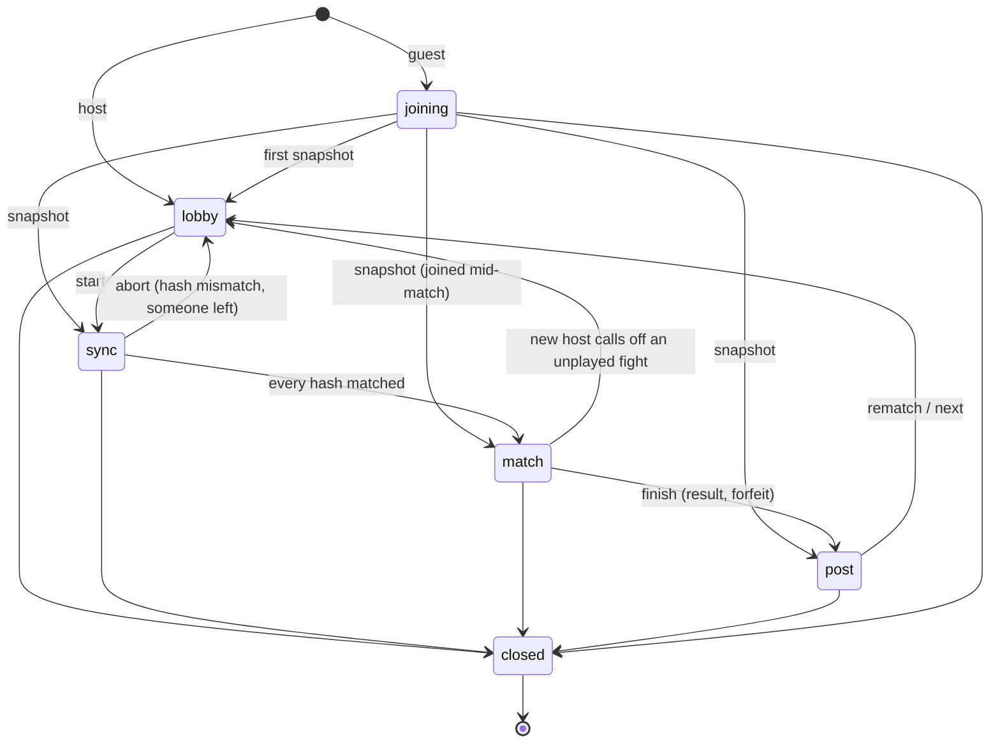
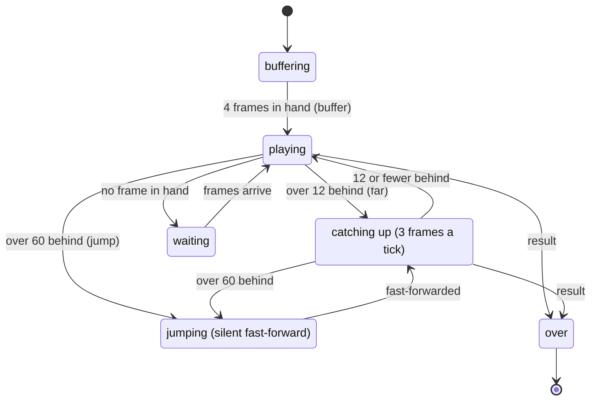
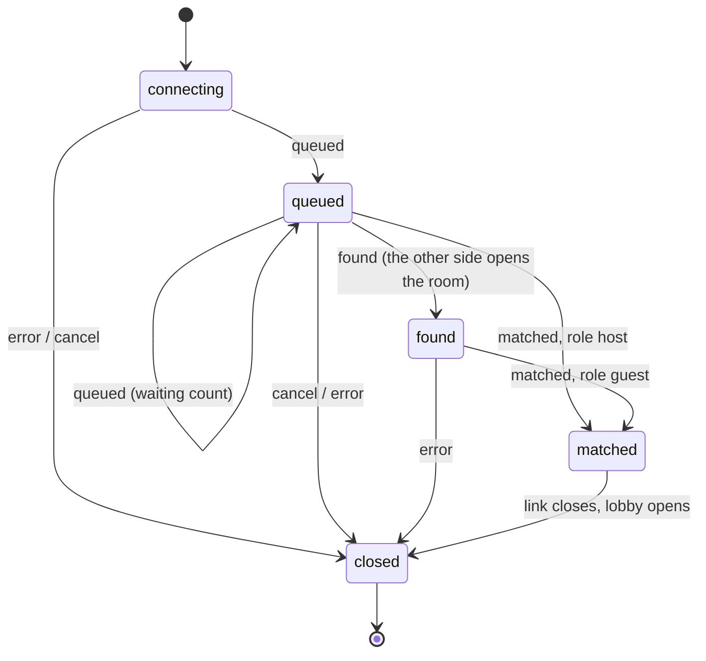
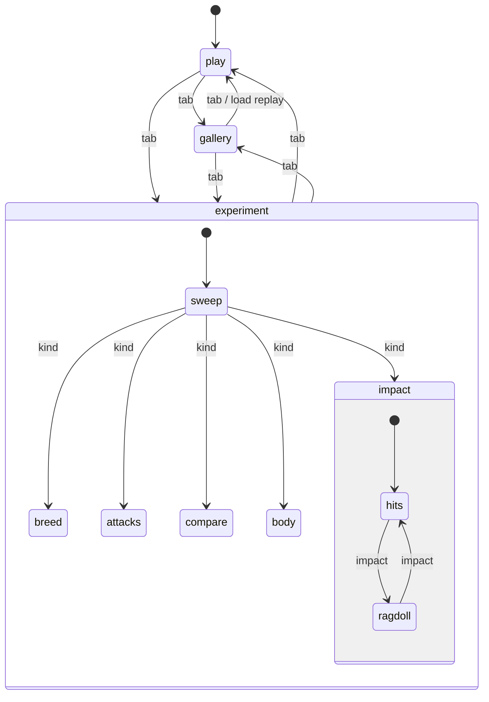

# State machines

The app's explicit state machines: where each lives, its states and the moves between them. Each table in the code is the source of truth; keep these diagrams in step when you change one.

| Machine | Code | Inspect it |
|---|---|---|
| [Lobby phase](#lobby-phase) | `LOBBY_PHASES`, `lobby.go()` in `src/net/lobby.js` | `lobby.inspect()`, ⌘K **netplay: lobby state** |
| [Spectator playback](#spectator-playback) | `NETWATCH_STATES`, `NetWatch.watchState` in `src/net/netmatch.js` | the netplay status line |
| [Quick match](#quick-match) | `QUICK_STATES`, `netServerQuick()` in `src/net/netserver.js` | `link.state`, `quickStatus(link)` |
| [Lab view](#lab-view) | `LAB_MODES`, `labIs()` in `src/editor/lab.js` | the play / gallery / experiment tabs |

## Lobby phase

The host moves only along `LOBBY_PHASES`; guests take the host's snapshots. The server shows only these phases in its room list, metrics and MCP tools. Every change is kept in `lobby.trail` (last 20). See [netplay.md](netplay.md#the-lobby-layer-3).

## Spectator playback

Worked out from `started` and how many frames the spectator holds (`behind`), by the same thresholds `tick()` uses (`NETWATCH`). It changes nothing about playback.

## Quick match

The client side of the server's quick-match queue. A message out of order (a late `queued` after `found`) is ignored. The side that waited longer is sent `matched` straight from `queued` and opens the room; the other gets `found` first. See [server.md](server.md#quick-match-and-ratings).

## Lab view

One mode at a time, set by the tab (`setMode` → `labMode.enter`; anything else falls back to play). In experiment, `lab.kind` (`BREED_TIPS`; any kind can follow any other, the diagram shows them from the default) picks what the nine cells compare, and impact has `lab.impact` on top. Ask with `labIs(mode, ...kinds)` and `labRagdoll()`.

Not a state machine here: the world's run (KO countdown, done, replaying) stays as flags in `src/engine/world.js`, because it is determinism-critical engine code.
